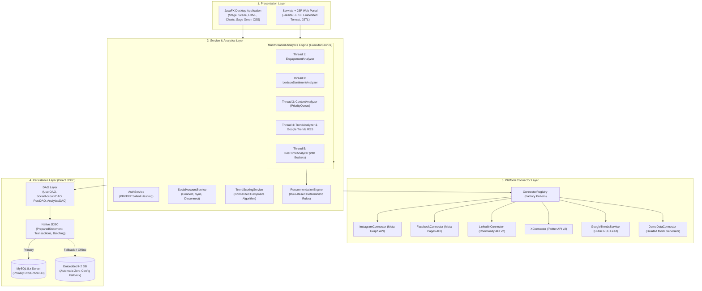

# TrendSense — Social Media Analytics & Trend Engine

[](https://openjdk.org/projects/jdk/21/)
[](https://maven.apache.org/)
[](https://openjfx.io/)
[](https://jakarta.ee/)
[](https://www.h2database.com/)
[](LICENSE)

> **TrendSense** is an enterprise-grade multi-platform social media intelligence system engineered entirely in Java. It empowers creators, marketing agencies, and analysts to authorize official accounts across **Instagram**, **Facebook**, **LinkedIn**, and **X (Twitter)**, fetch verified metrics, analyze sentiment and growth trends concurrently using high-performance multithreading, and derive actionable, rule-based strategic recommendations.

---

## 📑 Table of Contents
1. [Key Features & Capabilities](#-key-features--capabilities)
2. [Architecture & Design Principles](#-architecture--design-principles)
3. [Prerequisites & System Requirements](#-prerequisites--system-requirements)
4. [Quick Start & Installation](#-quick-start--installation)
5. [Demo Mode vs. Live Mode](#-demo-mode-vs-live-mode)
6. [Database Setup & Automatic Fallback](#-database-setup--automatic-fallback)
7. [Official API Configuration & Developer Setup](#-official-api-configuration--developer-setup)
8. [Trend Scoring Engine & Formula](#-trend-scoring-engine--formula)
9. [Sentiment Analysis Architecture](#-sentiment-analysis-architecture)
10. [Rule-Based Recommendation Engine](#-rule-based-recommendation-engine)
11. [Multithreaded Analytics Concurrency](#-multithreaded-analytics-concurrency)
12. [Automated Testing Suite](#-automated-testing-suite)
13. [Troubleshooting & FAQs](#-troubleshooting--faqs)
14. [Security & Privacy Audit](#-security--privacy-audit)
15. [License](#-license)

---

## 🌟 Key Features & Capabilities

- **Dual Presentation Interfaces**:
  - **Modern JavaFX Desktop Application**: Modular FXML dashboards with contemporary Sage Green styling, responsive chart visualizations (`BarChart`, `PieChart`, `LineChart`), `TableView` metric exploration, and interactive modal dialogs.
  - **Jakarta Servlets + JSP Web Portal**: Full-featured server-side rendered analytics interface hosted on an embedded Tomcat server with zero client-side framework bloat.
- **Multi-Platform Metric Normalization**:
  - Unifies disparate data structures from **Instagram Graph API**, **Facebook Graph API**, **LinkedIn Community API**, and **X (Twitter) API v2** into standard domain entities (`Post`, `Comment`, `Engagement`, `Trend`).
  - Strict platform integrity: **Zero web scraping**, **no credential harvesting**, and **no simulated follower actions**.
- **Transparent Mathematical Trend Scoring**:
  - Computes composite trending scores with configurable weights for mention volume, engagement rates, period-over-period growth velocity, and time-decay recency.
  - Integrates real-time external trend velocity via **Google Trends RSS**.
- **High-Performance Concurrency**:
  - Powered by Java `ExecutorService` and Java 21 Virtual Threads, executing engagement aggregation, sentiment scoring, best-time calculations, and hashtag clustering in parallel.
- **Rule-Based Recommendation Engine**:
  - Generates transparent, deterministic strategies (e.g., peak posting windows, format adjustments, sentiment warnings) without black-box AI hallucinations.
- **Zero-Friction Portability**:
  - Automatic database failover: seamlessly falls back to an embedded, in-memory/file-based **H2 database (in MySQL mode)** if an external MySQL instance is offline.

---

## 🏛️ Architecture & Design Principles



### Core Java Curriculum Concepts Demonstrated
| Concept | Concrete Implementation in Codebase |
| :--- | :--- |
| **Object-Oriented Programming** | Polymorphic connectors implementing `SocialMediaConnector`, abstract base `AbstractSocialMediaConnector`, domain entity encapsulation, and factory registries. |
| **Exception Handling** | Custom typed hierarchy (`SocialAnalyticsException` $\rightarrow$ `DatabaseException`, `ApiException`, `AuthenticationException`), graceful degradation, and transactional rollback. |
| **Collections Framework** | `HashMap` and `TreeMap` for metric aggregation, `HashSet` for stop-word filtering, `PriorityQueue` (Min-heap for Top/Bottom post ranking). |
| **Multithreading** | Parallel execution via `ExecutorService`, `Callable<T>`, and `Future<T>` with atomic progress reporting to the UI. |
| **JavaFX & Modern CSS** | Declarative FXML, custom Sage Green design tokens, responsive layouts, data binding, and `javafx.concurrent.Task` thread decoupling. |
| **Direct JDBC** | Zero ORM bloat: parameterized `PreparedStatement`, batch executions (`executeBatch`), and explicit transaction controls (`setAutoCommit(false)`). |
| **Jakarta Servlets & JSP** | MVC web architecture with clean separation: Servlets handle business routing; JSP/EL/JSTL strictly format presentation. |

---

## 💻 Prerequisites & System Requirements

Ensure the following tools are installed on your host machine:

- **Java Development Kit (JDK)**: Java 17 LTS or Java 21 LTS (Oracle OpenJDK, Eclipse Temurin, or Amazon Corretto).
  ```bash
  java -version
  ```
- **Apache Maven**: Version 3.9.0 or higher (or execute using the included `mvn.bat` / `./mvnw`).
  ```bash
  mvn -version
  ```
- **MySQL Database Server (Optional)**: Version 8.0+. *(Not required to run or evaluate the app; TrendSense automatically falls back to embedded H2 if MySQL is unavailable).*
- **Operating System**: Windows 10/11, macOS, or Linux.

---

## 🚀 Quick Start & Installation

### 1. Clone the Repository
```bash
git clone https://github.com/nrnjn-06/TrendSense.git
cd TrendSense
```

### 2. Configure Environment Variables
Copy the template configuration file:
```bash
# Windows PowerShell
copy .env.example .env

# Linux / macOS
cp .env.example .env
```
*(By default, `.env.example` is pre-configured for zero-setup execution using embedded H2 in Demo Mode. No edits are required to test the application immediately.)*

### 3. Run the JavaFX Desktop Dashboard
Double-click `run-desktop.bat` (Windows) or execute via Maven:
```powershell
.\mvn.bat javafx:run
```
*(On Linux/macOS: `mvn javafx:run`)*

- **Guest Demo Access**: Click **"⚡ Quick Guest Demo Access"** on the login screen to enter the pre-populated dashboard immediately.
- **Account Exploration**: View unified cross-platform engagement metrics, interactive charts, and post breakdowns.
- **Trigger Analytics**: Click **"⟳ Run Analytics"** to experience the multithreaded calculation engine.

### 4. Run the Jakarta Servlets + JSP Web Portal
Double-click `run-web.bat` (Windows) or execute via Maven:
```powershell
.\mvn.bat exec:java "-Dexec.mainClass=com.socialanalytics.web.WebServer"
```
Once initialized, open your browser and navigate to:
👉 **`http://localhost:8080/`**

| Web Endpoint | Description |
| :--- | :--- |
| `/login` / `/register` | User authentication with PBKDF2 password hashing |
| `/dashboard` | Central performance overview and KPI metric cards |
| `/posts` | Complete normalized post corpus with sorting and platform badges |
| `/trends` | Topic velocity rankings with formula explanations |
| `/sentiment` | Audience sentiment breakdown and emotional keyword cloud |
| `/best-time` | 24-hour engagement schedule optimization matrix |
| `/recommendations` | Deterministic, actionable growth strategies |
| `/connect` | Social media account connection manager |

---

## 🔄 Demo Mode vs. Live Mode

TrendSense guarantees strict separation between evaluation datasets and live production credentials:

```
┌────────────────────────────────────────────────────────────────────────┐
│                        TRENDSENSE ENGINE                               │
├───────────────────────────────────┬────────────────────────────────────┤
│           DEMO MODE               │            LIVE MODE               │
├───────────────────────────────────┼────────────────────────────────────┤
│ • Zero API credentials required   │ • Official OAuth tokens required   │
│ • Deterministic mock datasets     │ • Live Meta, X, LinkedIn APIs      │
│ • Fully offline operational       │ • Real audience metrics fetched    │
│ • Explicit "Demo Data" badge      │ • Authenticated channel badge      │
│ • Isolated in-memory state        │ • Synced to persistent database    │
└───────────────────────────────────┴────────────────────────────────────┘
```

- **Demo Mode**: Designed for academic evaluation, testing, and UI walkthroughs. Simulates realistic social media datasets across Instagram, Facebook, LinkedIn, and X without hitting rate limits or requiring developer accounts. Every view displays an unambiguous disclosure badge: *"Demo Data – Not connected to a live social-media platform."*
- **Live Mode**: Uses official OAuth 2.0 authorization codes and access tokens. Calls official platform endpoints over HTTPS and stores verified metrics in the database.
- **Integrity Guarantee**: Live Mode and Demo Mode datasets are completely isolated. Demo data is never intermingled with production accounts.

---

## 🗄️ Database Setup & Automatic Fallback

TrendSense incorporates a resilient dual-database persistence layer:

### Zero-Config Embedded H2 Fallback (Default)
If no local MySQL server is detected on `localhost:3306`, TrendSense automatically boots an embedded H2 database running in MySQL-compatibility mode (`jdbc:h2:./data/social_analytics;MODE=MySQL`). The schema (`schema.sql`) and necessary seed tables are automatically initialized. **No database installation or manual configuration is required.**

### Production MySQL Setup
To utilize an external MySQL database:
1. Ensure MySQL Server is running on port 3306.
2. Create the database:
   ```sql
   CREATE DATABASE social_analytics CHARACTER SET utf8mb4 COLLATE utf8mb4_unicode_ci;
   ```
3. Initialize the schema using `schema_mysql.sql`:
   ```bash
   mysql -u root -p social_analytics < schema_mysql.sql
   ```
4. Update your `.env` file:
   ```dotenv
   DB_HOST=localhost
   DB_PORT=3306
   DB_NAME=social_analytics
   DB_USER=your_mysql_username
   DB_PASSWORD=your_mysql_password
   ```

---

## 🔑 Official API Configuration & Developer Setup

To connect live accounts in Live Mode, register applications on official developer portals and provide your credentials in `.env`:

### 1. Instagram Graph API & Facebook Pages (Meta for Developers)
1. Navigate to [Meta for Developers](https://developers.facebook.com/) and create a Business App.
2. Add **Instagram Graph API** and **Facebook Login for Business** products.
3. Configure OAuth Redirect URI: `http://localhost:8080/connect/callback/meta` (or use the desktop access token generator).
4. Request permissions: `instagram_basic`, `instagram_manage_insights`, `pages_show_list`, `pages_read_engagement`.
5. Add credentials to `.env`:
   ```dotenv
   META_APP_ID=your_meta_app_id
   META_APP_SECRET=your_meta_app_secret
   INSTAGRAM_CLIENT_ID=your_instagram_app_id
   INSTAGRAM_CLIENT_SECRET=your_instagram_app_secret
   ```

### 2. X (Twitter) API v2 (X Developer Portal)
1. Visit the [X Developer Portal](https://developer.x.com/) and create a Project & App.
2. Enable OAuth 2.0 with PKCE and User Authentication Settings.
3. Set Callback URL: `http://localhost:8080/connect/callback/x`.
4. Required Scopes: `tweet.read`, `users.read`, `offline.access`.
5. Add credentials to `.env`:
   ```dotenv
   X_CLIENT_ID=your_x_client_id
   X_CLIENT_SECRET=your_x_client_secret
   X_BEARER_TOKEN=your_app_only_bearer_token
   ```

### 3. LinkedIn Community API (LinkedIn Developers)
1. Register an application on the [LinkedIn Developer Portal](https://developer.linkedin.com/).
2. Request the **Community Management API** or **Share on LinkedIn** product access.
3. Configure Redirect URI: `http://localhost:8080/connect/callback/linkedin`.
4. Scopes: `r_liteprofile`, `r_organization_social`, `rw_organization_admin`.
5. Add credentials to `.env`:
   ```dotenv
   LINKEDIN_CLIENT_ID=your_linkedin_client_id
   LINKEDIN_CLIENT_SECRET=your_linkedin_client_secret
   ```

### 4. Google Trends (Public RSS Integration)
- TrendSense integrates with Google Trends using official public RSS feeds (`https://trends.google.com/trending/rss?geo=US`).
- **No API key is required.** The integration handles rate limiting gracefully and parses trending search keywords dynamically.

---

## 📐 Trend Scoring Engine & Formula

TrendSense rejects arbitrary black-box scoring in favor of a normalized, mathematically transparent scoring model. Every sub-metric is normalized between `0` and `100` against the observed dataset:

$$\text{Trend Score} = (w_m \cdot S_{\text{mention}}) + (w_e \cdot S_{\text{engagement}}) + (w_g \cdot S_{\text{growth}}) + (w_r \cdot S_{\text{recency}})$$

### Weights Breakdown (Configurable in `.env` and Settings UI):
| Component | Weight | Mathematical Definition | Purpose |
| :--- | :--- | :--- | :--- |
| **Mention Volume ($S_m$)** | `0.25` | $\frac{\text{Topic Mentions}}{\max(\text{Mentions})} \times 100$ | Measures overall audience conversation volume |
| **Engagement Rate ($S_e$)** | `0.35` | $\frac{\text{Avg Interactions per Post}}{\max(\text{Avg Interactions})} \times 100$ | Rewards meaningful likes, shares, and comments |
| **Growth Velocity ($S_g$)** | `0.25` | Normalized period-over-period expansion percentage: $\frac{\text{Current} - \text{Previous}}{\text{Previous}} \times 100$ | Identifies rapidly accelerating breakout topics |
| **Time Recency ($S_r$)** | `0.15` | Linear time decay over a 14-day recency window | Prevents stale topics from lingering at top ranks |

### Status Classification:
- **RISING**: Growth velocity $\ge +15\%$ with strong engagement momentum.
- **FALLING**: Growth velocity $\le -15\%$.
- **EMERGING**: Newly detected topic (previous baseline $= 0$) granted an initial acceleration bonus.
- **STABLE**: Active conversation with $< 15\%$ variance.

---

## 💬 Sentiment Analysis Architecture

The built-in `LexiconSentimentAnalyzer` executes zero-latency sentiment classification without cloud vendor lock-in:
- **Weighted Emotional Lexicon**: Words mapped to calibrated polarity scores (e.g., `superb`: +2.0, `innovative`: +1.8, `broken`: -2.0, `terrible`: -2.0).
- **Negation Inversion Engine**: Detects qualifiers (`not`, `never`, `hardly`, `cannot`) within a sliding word-window and reverses polarity (e.g., *"not bad"* evaluates positively; *"not working"* evaluates negatively).
- **Emoji Sentiment Mapping**: Accurately scores popular social media emojis (❤️, 🔥, 🚀, 😢, 😡, 👎).
- **Pluggable Architecture**: Implements the `SentimentAnalyzer` interface, allowing plug-and-play swapping with ONNX or Stanford CoreNLP models.

---

## 💡 Rule-Based Recommendation Engine

Rather than generating ambiguous recommendations, TrendSense implements deterministic, rule-based heuristics:

1. **Breakout Topic Rule**: When a topic is categorized as **RISING** (Growth $> +15\%$), recommends immediate content scheduling around that keyword.
2. **Format Optimization Rule**: Evaluates average interaction performance across post formats (Reel, Carousel, Image, Text) and suggests shifting production toward the highest-performing medium.
3. **Peak Timing Rule**: Aggregates interaction timestamps into 24-hour buckets and pinpoints the statistically optimal 2-hour publishing window.
4. **Hashtag Strategy Rule**: Identifies high-density, high-conversion hashtags and warns against saturated or low-performing tags.
5. **Audience Sentiment Alert**: Flags campaigns if negative feedback crosses $15\%$ and isolates recurring complaint terms for review.

---

## ⚡ Multithreaded Analytics Concurrency

TrendSense leverages a decoupled, asynchronous processing pipeline:
- **Worker Pool**: Analyzers run concurrently across a managed `ExecutorService` thread pool.
- **Independent Tasks**: Engagement aggregation, sentiment scoring, best-time calculations, and external RSS trend fetching run in parallel without thread contention.
- **Thread Safety**: Built using thread-safe collections (`ConcurrentHashMap`, atomic primitives) and non-blocking background workers (`javafx.concurrent.Task`).
- **UI Responsiveness**: Keeps the JavaFX Application Thread and Web Request threads completely unblocked during intensive calculations.

---

## 🧪 Automated Testing Suite

TrendSense includes a comprehensive suite of automated tests verifying core calculation integrity, security isolation, and database resilience.

To run the full test suite:
```powershell
.\mvn.bat test
```

### Coverage Highlights:
- **Metric Verification**: Validates engagement rates, growth calculations, and nullable view counts.
- **Sentiment Accuracy**: Verifies polarity scoring, negation flips, and emoji parsing.
- **Security & Mode Isolation**: Guarantees zero credential leakage and verifies strict isolation between Demo and Live environments.
- **Database Resilience**: Tests automatic schema creation, transaction rollbacks, and H2 fallback execution.

---

## 🛠️ Troubleshooting & FAQs

### Q1: JavaFX fails with `Graphics Device initialization failed` or headless environment
- **Solution**: JavaFX desktop UI requires a display environment. For headless Linux servers or CI/CD pipelines, test using:
  ```bash
  mvn test -Dtest="!UiVisualSnapshotTest"
  ```
  Or run the headless Web Application (`run-web.bat` / WebServer).

### Q2: Port 8080 is already in use
- **Solution**: Set the `PORT` environment variable before running the web server:
  ```powershell
  $env:PORT="8081"
  .\mvn.bat exec:java "-Dexec.mainClass=com.socialanalytics.web.WebServer"
  ```

### Q3: How do I reset the local database?
- **Solution**: Delete the local `./data` folder. TrendSense will automatically re-create the schema and tables upon the next application launch.

---

## 🔒 Security & Privacy Audit

TrendSense has been audited for open-source distribution and enterprise privacy:
- **Zero Hardcoded Secrets**: All API tokens, client secrets, and database credentials have been decoupled into `.env` and `System.getenv()`.
- **Git Protection**: `.gitignore` strictly excludes local configuration files (`.env`), database files (`data/`, `*.mv.db`), reports, and build artifacts (`target/`).
- **Zero Scraped Data**: No unauthorized web scrapers or private account scraping tools.
- **Password Security**: All local user accounts are secured using salted **PBKDF2** password hashing.

---

## 📄 License

This project is licensed under the **MIT License** — see the [LICENSE](LICENSE) file for full details.
